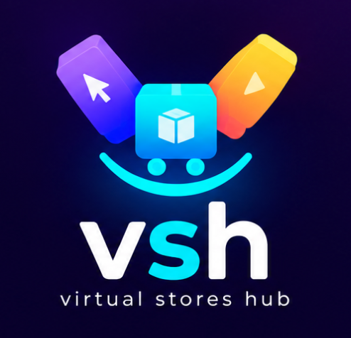

# VSH — Virtual Stores Hub

## Documentación Ejecutiva del Proyecto

**Documento preparado desde la perspectiva de desarrollo para la dirección de la compañía.**

VSH (Virtual Stores Hub) es una plataforma tecnológica para que tiendas físicas y virtuales puedan operar una tienda digital dentro de un ecosistema administrado por la compañía.

La propuesta combina cuatro elementos:

1. **Comercio digital:** cada tienda obtiene su propio espacio y URL.
2. **Gestión empresarial:** catálogo, inventario, sucursales, usuarios, pedidos y reportes.
3. **Logística:** la compañía coordina la recogida y entrega de los pedidos.
4. **Modelo SaaS:** la compañía cobra un fee por tienda y un fee de entrega al cliente final.

### Índice

- [01 — Resumen ejecutivo](01-Executive-Summary.md)
- [02 — Visión y propuesta de valor](02-Vision-and-Value-Proposition.md)
- [03 — Modelo de negocio e ingresos](03-Business-Model.md)
- [04 — Ecosistema de la plataforma](04-Platform-Ecosystem.md)
- [05 — Perfiles y permisos](05-User-Roles-and-Permissions.md)
- [06 — Gestión de tiendas](06-Store-Management.md)
- [07 — Catálogo e inventario](07-Catalog-and-Inventory.md)
- [08 — Pedidos y comercio](08-Orders-and-Commerce.md)
- [09 — Logística y entregas](09-Logistics-and-Delivery.md)
- [10 — Experiencia del cliente](10-Customer-Experience.md)
- [11 — Administración global](11-Platform-Administration.md)
- [12 — Arquitectura multi-tenant](12-Multi-Tenant-Architecture.md)
- [13 — Seguridad](13-Platform-Security.md)
- [14 — Notificaciones](14-Notifications-and-Communications.md)
- [15 — Reportes y analítica](15-Reports-and-Analytics.md)
- [16 — Planes y suscripciones](16-Subscription-and-Plans.md)
- [17 — MVP y roadmap](17-MVP-and-Roadmap.md)
- [18 — Flujo operativo](18-Operational-Workflow.md)
- [19 — Visión técnica](19-Technical-Overview.md)
- [20 — Escalabilidad y evolución](20-Scalability-and-Future.md)
- [21 — Riesgos y consideraciones](21-Risks-and-Considerations.md)
- [22 — Alcance del proyecto](22-Project-Scope.md)

## Principio rector

> VSH no debe ser solamente un creador de tiendas. Debe convertirse en la infraestructura tecnológica y logística mediante la cual la compañía pueda incorporar, administrar y hacer crecer múltiples comercios.